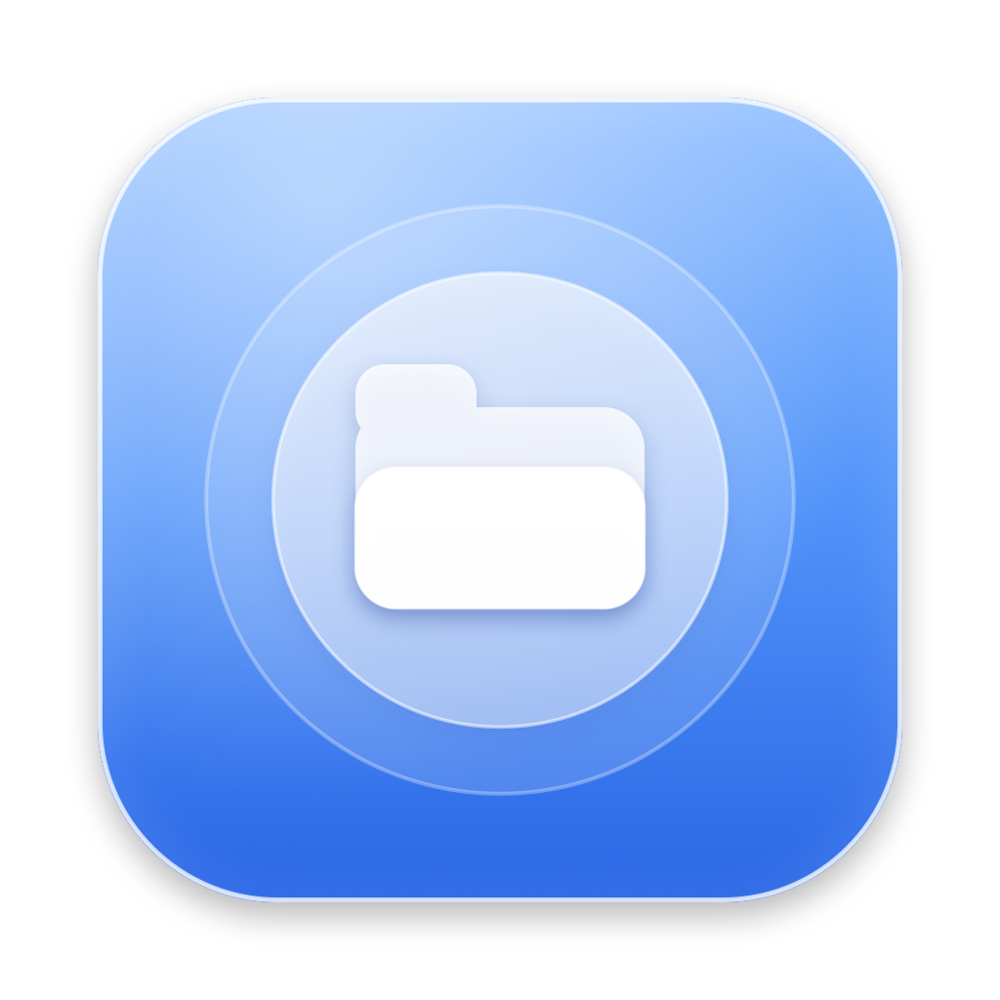
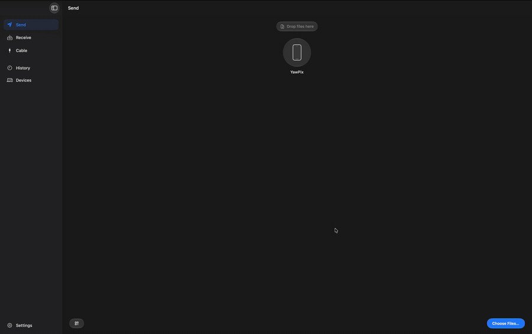
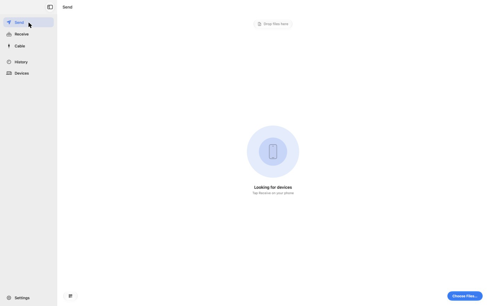
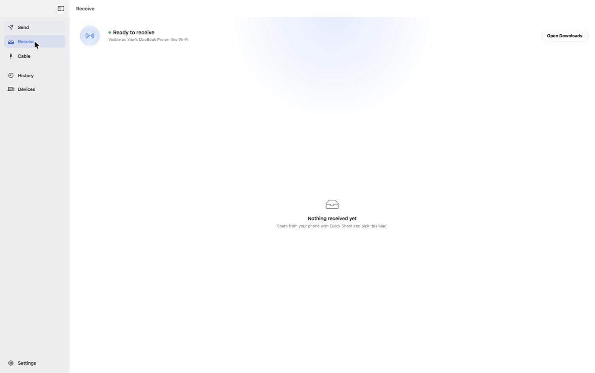
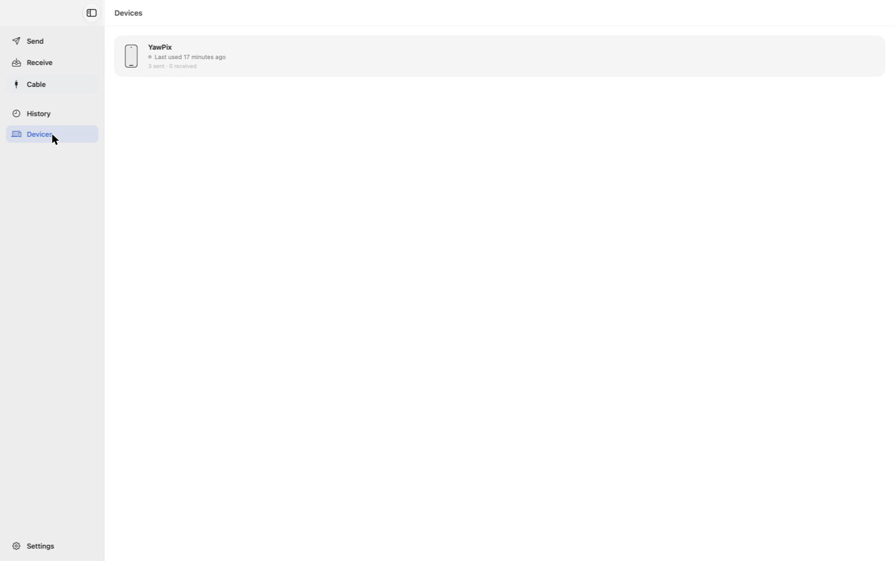
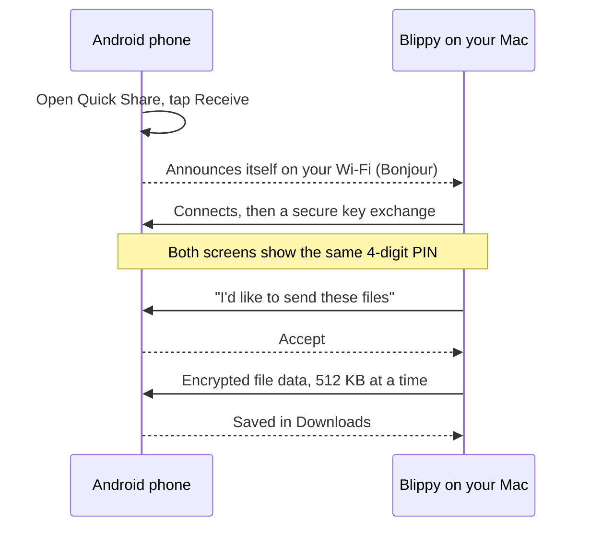

<p align="center">
  
</p>

<h1 align="center">Blippy</h1>

<p align="center">
  Send files between your Mac and your Android phone — over Wi-Fi or a USB cable.<br>
  Free, open source, and private: no accounts, no tracking, no data collected.
</p>

<p align="center">
  <a href="https://github.com/yaw595/blippy/releases/latest">
    
  </a>
  &nbsp;&nbsp;
  <a href="https://paystack.shop/pay/igugouqwlf">
    
  </a>
</p>

<p align="center">
  <a href="docs/INSTALL.md">Install help</a> ·
  <a href="docs/TROUBLESHOOTING.md">Troubleshooting</a> ·
  <a href="PRIVACY.md">Privacy</a> ·
  <a href="https://github.com/yaw595/blippy/releases">All releases</a>
</p>

<p align="center">
  <a href="docs/media/demo.mp4">
    
  </a>
  <br>
  <sub>▶ <a href="docs/media/demo.mp4">Watch the full 80-second demo</a>: Wi-Fi send, cable transfer, history</sub>
</p>

---

## What it does

- **Wi-Fi, both directions.** Uses Google's Quick Share protocol, so your phone's built-in Quick Share
  sees your Mac. Send from the Finder **Share** menu, drag files onto a phone, or receive from the phone.
- **USB cable for big files.** Pushes files straight into the phone's **Downloads** folder with `adb`,
  checks that every file arrived complete, and shows speed and time left.
- **Several phones at once**, with progress for each.
- **Folders** are zipped for you. **File previews**, sounds and notifications tell you what's happening.
- **History and Devices** pages, kept on your Mac only. Remove an entry, or delete a received file for good.
- Native Mac app: menu bar, full screen, Dock badge for waiting transfers, global shortcut **⌃⌥N**.

<p align="center">
  
  
</p>
<p align="center">
  
  
</p>
<p align="center">
  
</p>

> Built and tested with a Pixel 6 Pro and a recent Mac. Reports from other phones and Macs are very welcome.

## Install

1. Download `Blippy-x.y.z.dmg` from the [latest release](https://github.com/yaw595/blippy/releases/latest).
2. Open it and drag **Blippy** to **Applications**.
3. **First launch:** Blippy is not signed with a paid Apple developer certificate, so macOS asks you to
   confirm it once. Open **System Settings → Privacy & Security**, scroll down, click **Open Anyway**
   next to Blippy, and confirm. ([Step-by-step with alternatives](docs/INSTALL.md).)
4. Allow **notifications** and **local network** access when macOS asks.

Requires **macOS 14 (Sonoma) or later** and an Android phone with Quick Share (Android 6+ with Google Play services).

## Use it

| I want to… | Do this |
|---|---|
| Send over Wi-Fi | On the phone, open **Quick Share** and tap **Receive**. In Blippy, drop files or click **Choose Files**, then click the phone. |
| Send from Finder | Right-click a file → **Share → Blippy**. (Enable it once in System Settings → General → Login Items & Extensions → Sharing.) |
| Receive | On the phone, **Share → Quick Share →** your Mac. Accept in the notification or on the Receive page. Files land in **Downloads**. |
| Send over cable | Plug in the phone, turn on **USB debugging** (the Cable page shows how), tap **Allow** on the phone, then drop files on the Cable page. |

## How it works

Blippy is a Mac app that speaks the same **Quick Share** protocol as your phone, so nothing needs installing on
the phone. For big files it can also push over a USB cable with `adb`.



### Sending over Wi-Fi

1. **Finding the phone.** While Quick Share's *Receive* screen is open, the phone announces a Bonjour service
   (`_FC9F5ED42C8A._tcp`) on your local network, with its name and device type. Blippy browses for it, so the phone
   appears within a few seconds. If nothing is found, Blippy searches again every 5 seconds.
2. **Connecting securely.** Blippy opens a TCP connection and runs the **UKEY2** handshake (a P-256 key exchange).
   That produces keys for the session. Every message after that is encrypted with **AES-256-CBC** and signed with
   **HMAC-SHA256**, so only your two devices can read the files.
3. **Checking it is really your phone.** Both devices derive a **4-digit PIN** from the handshake. Blippy shows it,
   and the phone shows it too. If they match, nobody is sitting in the middle.
4. **Asking permission.** Blippy sends the list of files (names, sizes, types). The phone asks you to accept.
5. **Sending.** Files go in **512 KB chunks**, with several chunks in flight at once so the Mac can encrypt the next
   one while the previous ones are still on the wire. Blippy shows progress, speed and time left. Sending to
   several phones at once runs one connection per phone.

Folders can't be sent over Quick Share, so Blippy zips them first. A **QR code** (the button next to *Choose Files*)
is a shortcut for phones that don't show up: scanning it opens Quick Share on the phone with a one-time key, and the
phone then identifies itself to your Mac, which starts the send automatically.

### Receiving

Blippy advertises itself the same way, on a random port, while it is running (it lives in the menu bar). When a
phone sends something, you get a notification (it shows the PIN) and a row on the **Receive** page, both with **Accept**
and **Decline**. Accepted files are written to your **Downloads** folder, never overwriting anything: a clash
becomes `name (1).ext`. A transfer that goes silent for 90 seconds is marked as failed instead of spinning forever.

### Sending over a USB cable

Quick Share depends on your Wi-Fi, so for very large files Blippy has a second path that doesn't.

1. Blippy includes Google's `adb` (Android Debug Bridge). When the **Cable** page is open it checks every 2 seconds,
   and the moment you plug in or unplug a phone, whether a phone is connected, authorized (**USB debugging** on, and you
   tapped **Allow**) or still needs setup. The page tells you which step is next.
2. It copies each file into the phone's **Downloads** folder with `adb push`, using a new name if one is already
   there. Progress comes from watching the file grow on the phone.
3. When a copy finishes, Blippy checks that the file on the phone is **exactly the same size**. If it isn't, it deletes
   the partial file and tells you. A copy that stops growing for 90 seconds is stopped, and cancelling removes the
   partial file.
4. It then asks the phone to index the file so it shows up in the Files app right away.

`adb` is the same tool Android developers use. Blippy shares its background server with Android Studio and any `adb`
you run yourself, so the "Allow" you tapped once also works there.

### The Finder Share menu

Right-click a file → **Share → Blippy** opens a small sheet in Finder. It is a separate, sandboxed process that uses
the same sending code as the app (`ShareExtension/`). Because it is separate, it always follows your Mac's Light/Dark
setting and does not record history.

### What Blippy stores on your Mac

| What | Where |
|---|---|
| Transfer history (names, device, date, size) | `~/Library/Application Support/Blippy/history.json`, removable from the History page |
| Settings (sounds, appearance, last device) | your standard macOS preferences |
| Received files | your **Downloads** folder |
| Folders being zipped to send | a temporary folder, deleted when the send ends |

Nothing is sent to any server. Blippy makes no internet connections of its own. [Privacy statement](PRIVACY.md).

### Permissions it asks macOS for

- **Notifications**, to tell you someone wants to send you a file.
- **Local Network**, to find your phone and be found by it on your Wi-Fi.
- **Files and folders**, only the ones you pick or drop in. The main app is not sandboxed, because it runs `adb` and
  talks to USB; the Finder Share sheet is sandboxed.

### Limits to know about

- Wi-Fi transfers need the **Mac and phone on the same network**, and the phone on the **Quick Share Receive
  screen** (visibility set to *Everyone*). macOS apps can't send the Bluetooth signal that wakes Quick Share, so
  Blippy can't wake the phone itself. The QR code is the workaround.
- It speaks **Quick Share**, not AirDrop, so it's for Android phones. (Google's own Quick Share-to-AirDrop feature
  is limited to newer Pixels and doesn't involve Blippy.)
- Cable transfer needs **USB debugging**, which is an Android developer option.
- Photos and videos can also be sent to a phone in *Photo transfer* mode through Apple's Image Capture. That path is
  experimental, because Apple has deprecated the API it uses; `adb` is the dependable cable route.
- Blippy is signed without a paid Apple certificate, so macOS asks you to confirm the first launch
  ([how](docs/INSTALL.md)).

## Build from source

Requirements: a Mac with **Xcode 26 or later** (it uses the macOS 26 SDK for Liquid Glass and runs on macOS 14+). It is developed with a recent Xcode beta; if an older Xcode fails to build, please open an issue.

```bash
git clone https://github.com/yaw595/blippy.git
cd blippy
./scripts/fetch-adb.sh        # downloads Google's adb into Vendor/ (needed for cable transfer)
open Blippy.xcodeproj          # build and run the "Blippy" scheme
```

To make a distributable disk image: `./scripts/build-dmg.sh` (output in `dist/`).

See [CONTRIBUTING.md](CONTRIBUTING.md) for how the code is laid out.

## Privacy

Blippy collects **no data** — no analytics, crash reports, accounts or servers. Files go directly
between your devices. Read the [privacy statement](PRIVACY.md).

## Support the project

Blippy is free. If it saves you time, you can
[buy me a coffee](https://paystack.shop/pay/igugouqwlf). It is entirely optional.

## Where Blippy came from

Blippy grew out of **[NearDrop](https://github.com/grishka/NearDrop)** by **Grishka**, an open-source Mac app that
receives files from Android over Quick Share. NearDrop did the hard part: working out Google's Quick Share protocol and
writing a Swift implementation of it. That work is the foundation of Blippy (the `NearbyShare/` framework, and the
protocol notes in [docs/PROTOCOL.md](docs/PROTOCOL.md)). NearDrop is released into the public domain (see
[LICENSES/NearDrop-Unlicense.txt](LICENSES/NearDrop-Unlicense.txt)), which is what allows Blippy to build on it. Thank you, Grishka.

What Blippy adds on top: a full Mac app and window (instead of a menu-bar receiver), sending to phones and to several at
once, the cable transfer with `adb`, History and Devices pages, file previews, Light/Dark themes, faster sending for
large files, and a fix for phones that open Quick Share after the Mac is already looking.

## License and credits

Blippy is released under the [Apache License 2.0](LICENSE).

It uses swift-protobuf, SwiftECC and Android's `adb`, in addition to the NearDrop foundation described above.
See [THIRD_PARTY_NOTICES.md](THIRD_PARTY_NOTICES.md).

Android, Quick Share and Pixel are trademarks of Google LLC. Blippy is an independent project and is
not affiliated with, endorsed by or sponsored by Google, Apple or the NearDrop project.
