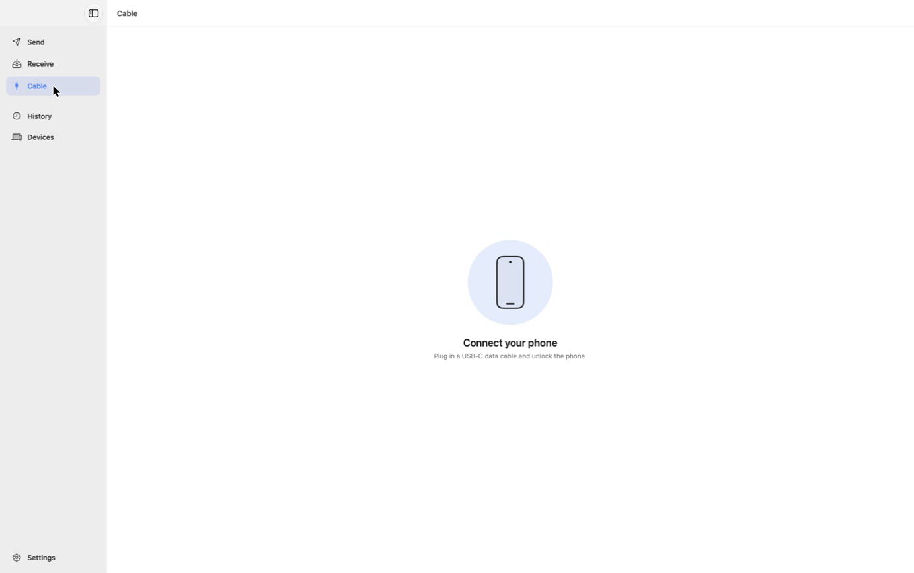
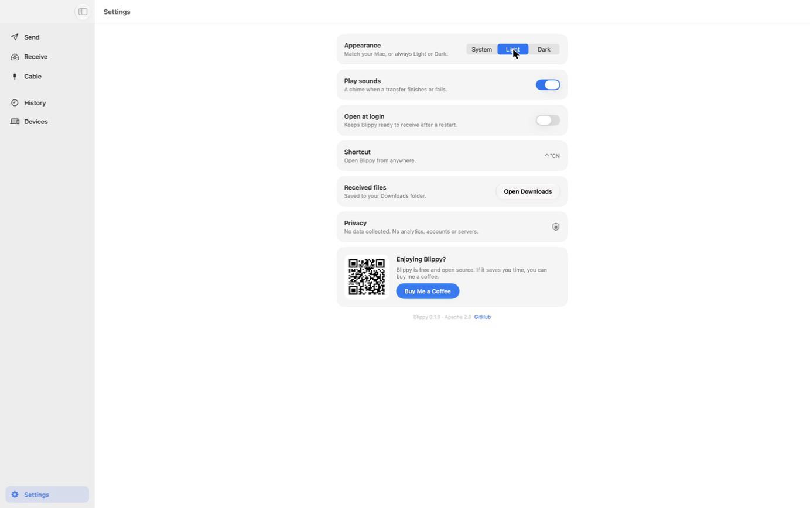

<p align="center">
  
</p>

<h1 align="center">Blippy</h1>

<p align="center">
  Send files between your Mac and your Android phone — over Wi-Fi or a USB cable.<br>
  Free, open source, and private: no accounts, no tracking, no data collected.
</p>

<p align="center">
  <a href="https://github.com/yaw595/blippy/releases/latest">
    
  </a>
</p>

<p align="center">
  <a href="docs/INSTALL.md">Install help</a> ·
  <a href="docs/TROUBLESHOOTING.md">Troubleshooting</a> ·
  <a href="PRIVACY.md">Privacy</a> ·
  <a href="https://github.com/yaw595/blippy/releases">All releases</a>
</p>

<p align="center">
  <a href="docs/media/demo.mp4">
    
  </a>
  <br>
  <sub>▶ <a href="docs/media/demo.mp4">Watch the full 80-second demo</a>: Wi-Fi send, cable transfer, history</sub>
</p>

---

## What it does

- **Wi-Fi, both directions.** Uses Google's Quick Share protocol, so your phone's built-in Quick Share
  sees your Mac. Send from the Finder **Share** menu, drag files onto a phone, or receive from the phone.
- **USB cable for big files.** Pushes files straight into the phone's **Downloads** folder with `adb`,
  checks that every file arrived complete, and shows speed and time left.
- **Several phones at once**, with progress for each.
- **Folders** are zipped for you. **File previews**, sounds and notifications tell you what's happening.
- **History and Devices** pages, kept on your Mac only. Remove an entry, or delete a received file for good.
- Native Mac app: menu bar, full screen, Dock badge for waiting transfers, global shortcut **⌃⌥N**.

<p align="center">
  
  
</p>
<p align="center">
  
  
</p>
<p align="center">
  
</p>
> Built and tested with a Pixel 6 Pro and a recent Mac. Reports from other phones and Macs are very welcome.

## Install

1. Download `Blippy-x.y.z.dmg` from the [latest release](https://github.com/yaw595/blippy/releases/latest).
2. Open it and drag **Blippy** to **Applications**.
3. **First launch:** Blippy is not signed with a paid Apple developer certificate, so macOS asks you to
   confirm it once. Open **System Settings → Privacy & Security**, scroll down, click **Open Anyway**
   next to Blippy, and confirm. ([Step-by-step with alternatives](docs/INSTALL.md).)
4. Allow **notifications** and **local network** access when macOS asks.

Requires **macOS 14 (Sonoma) or later** and an Android phone with Quick Share (Android 6+ with Google Play services).

## Use it

| I want to… | Do this |
|---|---|
| Send over Wi-Fi | On the phone, open **Quick Share** and tap **Receive**. In Blippy, drop files or click **Choose Files**, then click the phone. |
| Send from Finder | Right-click a file → **Share → Blippy**. (Enable it once in System Settings → General → Login Items & Extensions → Sharing.) |
| Receive | On the phone, **Share → Quick Share →** your Mac. Accept in the notification or on the Receive page. Files land in **Downloads**. |
| Send over cable | Plug in the phone, turn on **USB debugging** (the Cable page shows how), tap **Allow** on the phone, then drop files on the Cable page. |

## Build from source

Requirements: a Mac with **Xcode 26 or later** (it uses the macOS 26 SDK for Liquid Glass and runs on macOS 14+). It is developed with a recent Xcode beta; if an older Xcode fails to build, please open an issue.

```bash
git clone https://github.com/yaw595/blippy.git
cd blippy
./scripts/fetch-adb.sh        # downloads Google's adb into Vendor/ (needed for cable transfer)
open NearDrop.xcodeproj       # build and run the "NearDrop" scheme (the Blippy app)
```

To make a distributable disk image: `./scripts/build-dmg.sh` (output in `dist/`).

The Xcode project and source folders keep the name *NearDrop* because Blippy grew out of that project.
See [CONTRIBUTING.md](CONTRIBUTING.md) for how the code is laid out.

## Privacy

Blippy collects **no data** — no analytics, crash reports, accounts or servers. Files go directly
between your devices. Read the [privacy statement](PRIVACY.md).

## Support the project

Blippy is free. If it saves you time, you can
[buy me a coffee](https://paystack.shop/pay/igugouqwlf). It is entirely optional.

## License and credits

Blippy is released under the [Apache License 2.0](LICENSE).

It is based on [NearDrop](https://github.com/grishka/NearDrop) by Grishka (public domain), and uses
swift-protobuf, SwiftECC and Android's `adb`. See [THIRD_PARTY_NOTICES.md](THIRD_PARTY_NOTICES.md).

Android, Quick Share and Pixel are trademarks of Google LLC. Blippy is an independent project and is
not affiliated with, endorsed by or sponsored by Google, Apple or the NearDrop project.
